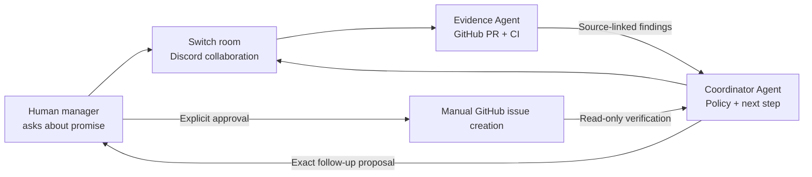
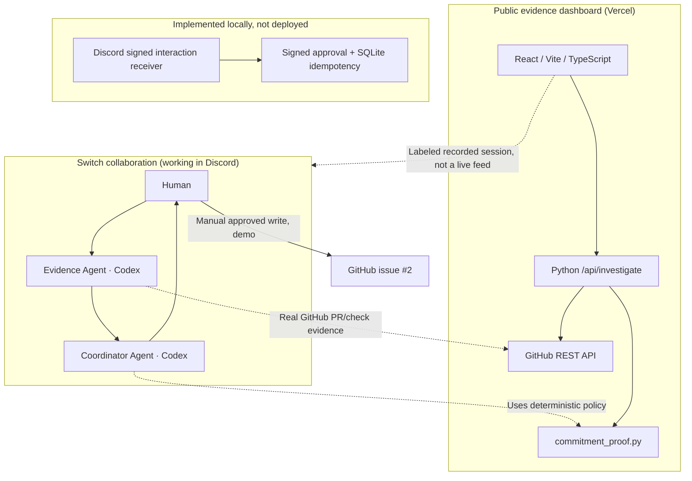

# CommitmentProof

**Prove it before you close it.**

**Flip the Switch Hackathon — Track 1: Best Business Workflow**

[Live dashboard](https://commitment-proof.vercel.app/) · [Recorded human-approved outcome](https://github.com/bh00mi-11/CommitmentProof/issues/2) · [Switch hackathon](https://www.wemakedevs.org/hackathons/switch)

> A merged pull request is not proof that a customer promise has been fulfilled.

## The problem

A support manager asks, **"Can we tell the customer their promised fix is delivered?"** A merged PR and green CI are encouraging, but neither proves the fix reached the customer's environment or passed QA. Premature completion claims erode trust.

## Our solution

**CommitmentProof** coordinates two distinct AI agents **inside a real Switch-connected Discord room**, with a human responsible for the final action:

1. **Human request** — A manager asks whether a specific promise is fulfilled.
2. **Evidence Agent** — Reads an actual GitHub PR and its check runs, attaches source links, and explicitly identifies missing evidence.
3. **Coordinator Agent** — Receives the Evidence Agent's findings in the same Switch room, applies a deterministic completion policy, and drafts a concrete follow-up.
4. **Human decision** — Reviews and approves or rejects the exact follow-up.
5. **Verified GitHub outcome** — In our demonstrated session, the human **manually** created the approved issue; the Coordinator independently checked its content and source links.

**The key differentiator:** Completion claims are evidence-gated. Merged code is not automatically treated as a delivered customer outcome.

## How Switch is used

This is not a two-agent simulation on a standalone dashboard. Two real Codex agents communicated through **Switch Console and a shared Discord room** named `#commitment-proof`:



| Participant | Actual responsibility |
| --- | --- |
| Human | Starts investigation, reviews proposal, approves the external action |
| Evidence Agent | Collects read-only GitHub evidence; does not invent deployment or QA proof |
| Coordinator Agent | Interprets evidence, prepares follow-up, confirms the GitHub result |
| Switch + Discord | Shared conversation, real agent-to-agent handoff, and human checkpoint |
| Dashboard | Visualizes source-linked investigations and a **recorded**, verified Switch session |

The dashboard is **not connected to a live Switch event feed**. It correctly labels recorded events as recorded. Its separate **Live investigation** mode does use a real read-only GitHub API.

## Verified end-to-end demonstration

We investigated **[microsoft/vscode PR #331010](https://github.com/microsoft/vscode/pull/331010)**:

| Evidence | Finding |
| --- | --- |
| PR merged | Verified |
| CI checks | 27/27 returned completed checks successful in the demonstrated investigation ([source](https://github.com/microsoft/vscode/commit/026fe5316ffc0998aab553b3ca3d4f36d8e8792f/checks)) |
| Deployment to customer environment | **Unknown** |
| QA reproduction / confirmation | **Unknown** |
| Delivery claim | **NEEDS_EVIDENCE** — do **not** tell customer the fix is delivered |

In Switch, the Evidence Agent handed source-linked findings to the Coordinator, who drafted a request for deployment and QA proof. The human approved the exact proposal, **manually created [CommitmentProof issue #2](https://github.com/bh00mi-11/CommitmentProof/issues/2)**, and the Coordinator verified that the issue existed, was open, and matched the approved title, body, and evidence links.

**Important:** This is an illustrative investigation of a public upstream VS Code PR. We do not claim to operate VS Code or to know the status of a real VS Code customer's environment. The issue is a demonstration follow-up in **our own** repository.

**Also important:** Human approval and issue creation were completed in the shared workflow, but the **automated signed Discord approval-to-GitHub writer is not deployed**. No automatic issue creation or customer communication is claimed.

## Architecture



### Main components

- `commitment_proof.py`: deterministic, fail-closed completion policy.
- `github_evidence.py`: read-only GitHub PR and check-run collector; unknown deployment/QA remains unknown.
- `frontend/`: React + Vite + TypeScript dashboard, evidence checklist, prominent verdict, recorded Switch handoff, and verified human outcome.
- `frontend/backend.py`: local JSON investigation API adapter.
- `api/investigate.py`, `api/health.py`: Vercel-hosted Python read-only API endpoints.
- `discord_approval_service.py`, `github_issue_approval.py`: locally tested, **not deployed** signed approval and privileged issue writer.
- `register_discord_command.py`, `discord_commands.json`: dry-run-by-default Discord command registration preparation.
- `tests/`: unit/integration tests covering evidence, approval safeguards, and API behavior.
- `switch/commitment-proof.template.yaml`: illustrative agent-room template; not a validated one-click Switch import.

## Try the public demo

**Dashboard:** https://commitment-proof.vercel.app/

**Recorded Switch session:** Open the `Recorded Switch session` tab. Read the Evidence Agent → Coordinator Agent handoff, the `NEEDS EVIDENCE` decision, the explicit human approval, and the [verified follow-up issue](https://github.com/bh00mi-11/CommitmentProof/issues/2). This is recorded real activity, **not** a live event stream.

**Live GitHub investigation:** Open `Live investigation`, enter repository `microsoft/vscode` and PR `331010`, and select **Check evidence**. The site invokes its server-side read-only collector and updates the checklist and verdict from GitHub data. Actual GitHub data can change; missing deployment/QA evidence must not be silently invented.

**Public API health:** `GET https://commitment-proof.vercel.app/api/health`

## Run locally

Requires **Python 3.10+**, **Node.js/npm**, and Git. On Windows PowerShell:

```powershell
git clone https://github.com/bh00mi-11/CommitmentProof.git
Set-Location CommitmentProof
python -m pip install -r requirements.txt
python -m unittest discover -s tests -v
```

Start the local read-only Python API in one PowerShell terminal:

```powershell
python frontend/backend.py
```

Start the UI in a **second** PowerShell terminal, from the same clone:

```powershell
Set-Location frontend
npm ci
npm run dev
```

Open the localhost URL printed by Vite. The Vite development proxy forwards `/api` to the local Python adapter on port `8766`. For production build, run `npm run build` from `frontend/`.

For a direct read-only PR check without the UI:

```powershell
python github_evidence.py microsoft/vscode 331010
```

Public GitHub repositories work without a token subject to GitHub rate limits. If needed, set `GITHUB_TOKEN` **server-side only**. Never put it in browser code or a `VITE_*` variable.

## Reproduce the Switch collaboration

1. Install [Switch Console](https://www.wemakedevs.org/hackathons/switch/resources) and connect a Discord server.
2. Create one room such as `#commitment-proof`.
3. Add two separate Codex agents, **Evidence Agent** and **Coordinator Agent**, with access to this cloned repository and room; permit agent-to-agent communication.
4. Ask the Evidence Agent in the room to investigate a specified PR using `github_evidence.py` and hand its source-linked findings to the Coordinator.
5. Have the Coordinator apply `commitment_proof.assess()`, identify missing proof, and draft an exact follow-up.
6. Human explicitly reviews the draft; for the demonstrated approach, the human manually creates a follow-up in a repository they control. The Coordinator verifies the actual GitHub issue. **Do not create test issues in an unrelated upstream repository.**

The Switch room and agent configuration require an actual Switch installation; the included YAML is a proposal rather than an established import format.

## Deploy the dashboard on Vercel

- Connect the GitHub repository, using production branch `main`.
- Set **Root Directory to the repository root** (`.` or `./`).
- The committed root `vercel.json` builds `frontend/`, publishes `frontend/dist`, and exposes root Python functions from `api/`.
- To access private repositories or reduce rate-limit issues, configure `GITHUB_TOKEN` as a **server-side** Vercel environment variable.
- Verify `/api/health`, then run an actual investigation on the public site.
- The Vercel deployment does **not** host Switch agents or the signed Discord approval service.

## Approval implementation and limitations

The repository includes a security-focused future automated route: Discord signature validation, immutable draft review, trusted Ed25519-signed approval proof, allowlisted Discord approver, SQLite execution state, and duplicate-detection logic. Local tests use mocked GitHub writes. **The trust-isolated service, public HTTPS interaction endpoint, secrets, and Discord command registration have not been deployed.** The real demonstration used explicit human approval and **manual GitHub issue creation**.

For detailed no-credential local tests and future trusted-host prerequisites, see [Windows Discord smoke-test guide](docs/windows-discord-smoke-test.md). No private keys or tokens are committed.

## Verify

```powershell
python -m unittest discover -s tests -v
Set-Location frontend
npm ci
npm test -- --run
npm run build
```

Latest reported project checks before this documentation update: **64/64 Python tests**, **6/6 frontend tests**, and a successful Vite build. These are reported results from the project workflow, not a fresh run by this README update.

## Demo / submission

- [Live website](https://commitment-proof.vercel.app/)
- [Source code](https://github.com/bh00mi-11/CommitmentProof)
- [Verified human-approved GitHub outcome](https://github.com/bh00mi-11/CommitmentProof/issues/2)
- **Demo video:** add the final public or unlisted YouTube/Loom link before submission.

**CommitmentProof does not independently verify customer deployment or QA, automatically announce delivery, or currently stream Switch events to Vercel. Its core demonstrated value is evidence-backed agent collaboration and human-controlled follow-through.**
