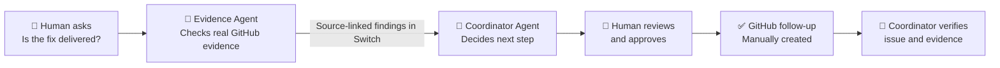
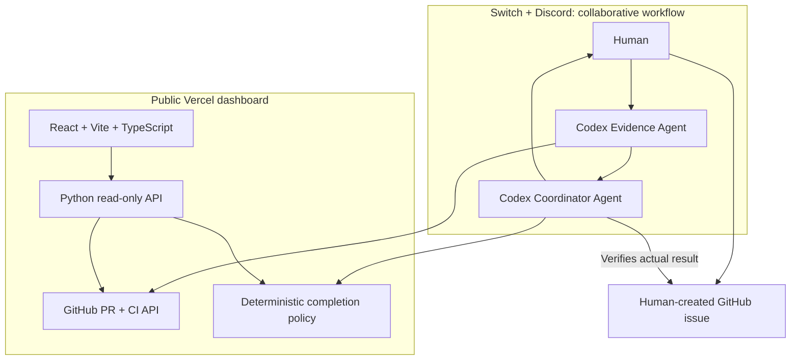

# CommitmentProof
### Prove it before you close it.

**Flip the Switch Hackathon · Track 1: Best Business Workflow**

[**Try the live dashboard**](https://commitment-proof.vercel.app/) · [**See the completed GitHub follow-up**](https://github.com/bh00mi-11/CommitmentProof/issues/2) · [**Source code**](https://github.com/bh00mi-11/CommitmentProof)

> **The question:** “Our fix was merged. Can we tell the customer it's delivered?”
>
> **Our answer:** Not until the evidence proves it.

## The story

Imagine a support manager about to tell a customer that their promised fix is complete. The pull request is merged. The CI pipeline is green. Everything looks done.

**But was it actually deployed? Did QA confirm the customer's problem is resolved?**

This is where **CommitmentProof** steps in. Inside a real **Switch-connected Discord room**, two AI agents work together to investigate the promise, distinguish proof from assumptions, and recommend the next responsible action. The human stays in control.

In our demonstration, the Evidence Agent examined [a real merged VS Code pull request](https://github.com/microsoft/vscode/pull/331010) and its [passing checks](https://github.com/microsoft/vscode/commit/026fe5316ffc0998aab553b3ca3d4f36d8e8792f/checks). The Coordinator Agent saw that deployment and QA evidence had not been established. Rather than declaring “done,” it drafted a precise follow-up. A human approved that draft, created the follow-up issue in our repository, and the Coordinator verified the result.

**[View verified GitHub issue #2](https://github.com/bh00mi-11/CommitmentProof/issues/2)**

The outcome isn't a confident but unsupported completion claim. It's an accountable next step, backed by evidence.

## One workflow. Two agents. Human accountability.



### Why Switch matters

This isn't two chatbots working separately. **Switch provides the shared collaboration room** where the human request, Evidence Agent findings, Coordinator handoff, and human decision happen in one conversation.

| Role | What it contributes |
| --- | --- |
| **Evidence Agent** | Reads real PR/check data and returns verifiable source links |
| **Coordinator Agent** | Applies a deterministic evidence policy, explains the decision, and prepares an actionable follow-up |
| **Human** | Reviews the proposed action and decides whether to execute it |
| **Switch** | Connects the participants in a shared Discord workflow with visible handoffs |

**Why this is a Track 1 business workflow:** A real team gets a real task done: from a business question through two-agent investigation and collaboration to a human-approved, independently verified GitHub follow-up.

## See the working example

**[Open CommitmentProof dashboard](https://commitment-proof.vercel.app/)**

Choose **Recorded Switch session** to see the actual investigation story, agent handoff, human approval, and completed issue. This recorded view represents a real Switch conversation, not a live event stream.

Choose **Live investigation** to enter a GitHub repository and PR number and run a **real read-only GitHub evidence check**.

For a quick test, use:

| Input | Value |
| --- | --- |
| Repository | `microsoft/vscode` |
| Pull request | `331010` |

The decision remains **NEEDS EVIDENCE** because the PR merge and checks alone do not verify deployment and QA. That is the feature, not a failure.

### Demonstrated result

- **Real GitHub evidence:** PR merged and 27 returned CI checks successful in the recorded investigation.
- **Real Switch collaboration:** Evidence Agent handed source-linked findings to Coordinator Agent in Discord.
- **Real human decision:** The exact follow-up proposal was approved in the room.
- **Real GitHub outcome:** [Issue #2](https://github.com/bh00mi-11/CommitmentProof/issues/2) was **manually created** in our repository, and the Coordinator verified its title, body, and source links.

*This is an illustrative use of a public VS Code PR. We do not claim to manage VS Code's customer deployments.*

## How it works



**Technology:** Switch Console, Discord, Codex agents, Python, GitHub REST API, React, Vite, TypeScript, Vercel. The deterministic policy treats missing or contradictory proof conservatively rather than relying on an LLM's confidence alone.

## Run the project

Requires Python 3.10+, Node.js/npm and Git.

```powershell
git clone https://github.com/bh00mi-11/CommitmentProof.git
cd CommitmentProof
python -m pip install -r requirements.txt
python -m unittest discover -s tests -v
```

**Terminal 1 — local read-only API:**

```powershell
python frontend/backend.py
```

**Terminal 2 — dashboard:**

```powershell
cd frontend
npm ci
npm run dev
```

Open the localhost URL displayed by Vite. The development proxy forwards `/api` to the local Python API on port 8766.

**Command-line evidence check:**

```powershell
python github_evidence.py microsoft/vscode 331010
```

For public GitHub repositories, unauthenticated reads are subject to GitHub rate limits. If needed, set `GITHUB_TOKEN` only in the **server process**, never in frontend/browser environment variables.

### Reproduce the Switch collaboration

1. Install [Switch Console](https://www.wemakedevs.org/hackathons/switch/resources), connect Discord, and create a shared room.
2. Add two Codex agents: an **Evidence Agent** with read-only evidence-investigation instructions, and a **Coordinator Agent** that applies policy and drafts follow-ups.
3. Ask the Evidence Agent in the shared room to investigate a PR using `github_evidence.py` and pass findings directly to the Coordinator.
4. Have the Coordinator apply `commitment_proof.assess()` and propose an exact, source-backed follow-up.
5. Human reviews and explicitly approves the action. For the demonstrated workflow, human manually creates an issue in a repository they control; the Coordinator verifies its URL and contents.

The `switch/commitment-proof.template.yaml` is an illustrative configuration, not a verified one-click Switch import.

## Project structure

| Path | Purpose |
| --- | --- |
| `commitment_proof.py` | Evidence-gated completion policy |
| `github_evidence.py` | Real read-only GitHub PR and check collection |
| `frontend/` | Judge-friendly dashboard, recorded session and live investigations |
| `api/`, `frontend/backend.py` | Vercel and local investigation API |
| `tests/` | Evidence, API and approval test coverage |
| `github_issue_approval.py`, `discord_approval_service.py` | Signed approval and issue-action implementation for future secure deployment |
| `docs/windows-discord-smoke-test.md` | Detailed approval-service testing and operator setup |

## Deploy on Vercel

Import this repository with **Production Branch `main`** and **Root Directory `./`** (repository root). The committed `vercel.json` builds `frontend/` and serves the Python functions in root `api/`.

Verify `/api/health` and a live investigation. For private GitHub data, add `GITHUB_TOKEN` as a **server-side** Vercel environment variable.

## Scope and trust

The **working demo** includes real Switch/Discord agent collaboration, GitHub evidence retrieval, deterministic assessment, explicit human approval in chat, manual issue creation, and Coordinator verification.

The public site shows **recorded Switch collaboration** and a separate **live GitHub investigation**, not live Switch event streaming. The repository also includes locally tested signed-approval automation, but that privileged Discord-to-GitHub service is **not deployed**. We do not claim automated issue creation, customer communication, or proof of deployment/QA.

For setup and security details of the future signed approval service, see [the Windows guide](docs/windows-discord-smoke-test.md).

---

**CommitmentProof — because “merged” and “delivered” are two different things.**
